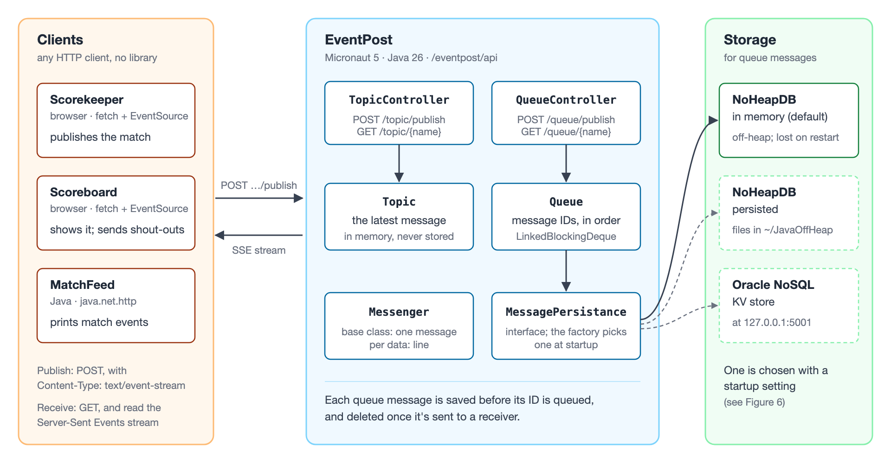
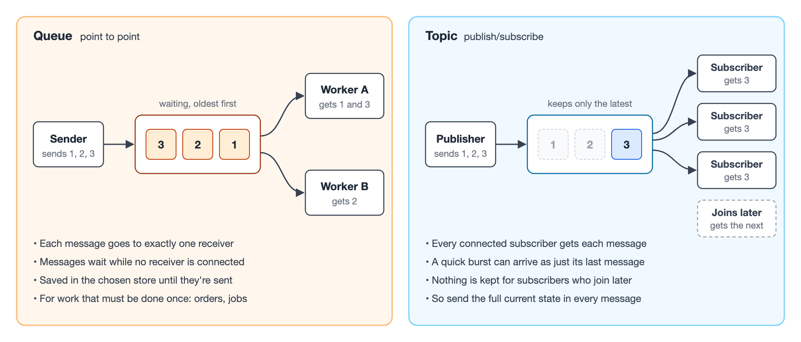
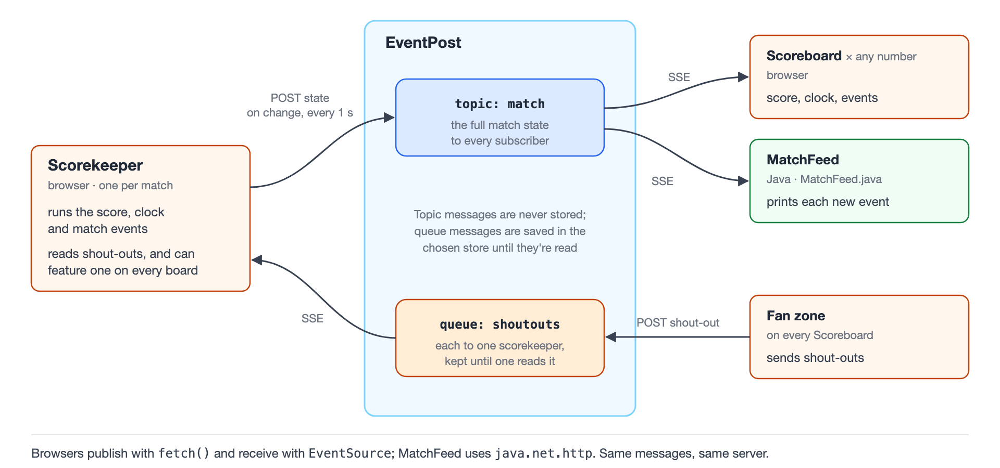
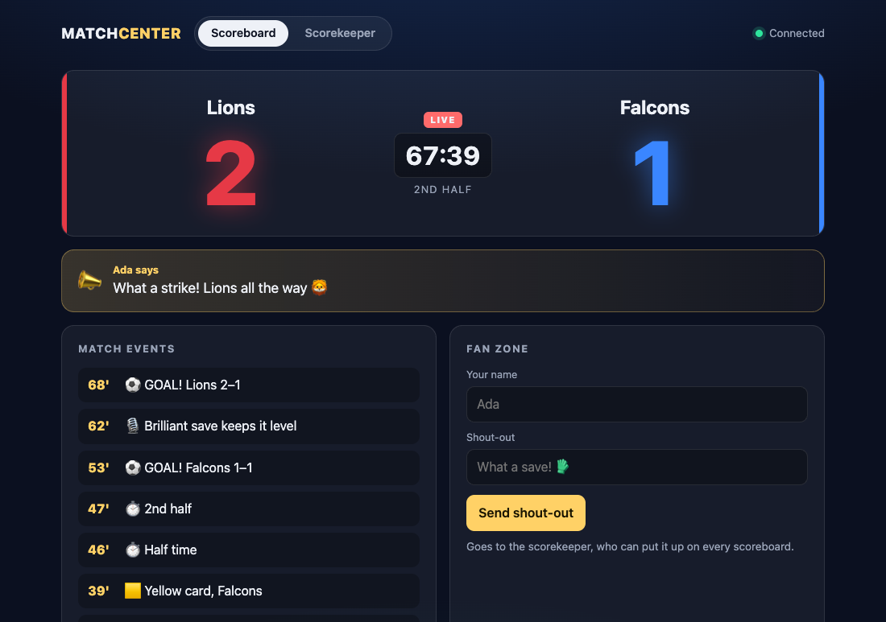
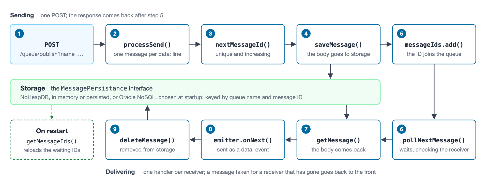
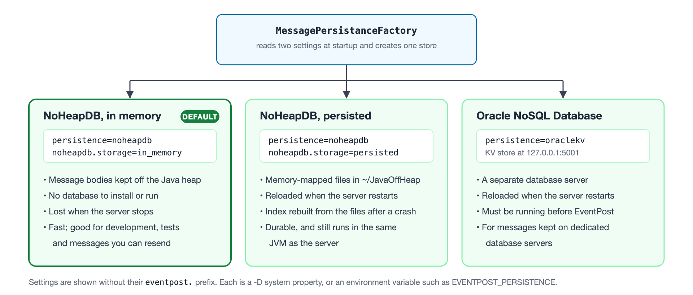

# HTML5 Server-Sent Events with Micronaut, Revisited

*Eric J. Bruno*

---

A few years ago, I wrote about a simple, reliable messaging system I built around Micronaut's support for HTML5 server-sent events (SSE). It grew out of an end-to-end IoT project, and it offered both queues and publish/subscribe topics over plain HTTP, with queued messages stored in Oracle NoSQL Database. I recently brought it up to date and gave it a new name, [EventPost](https://github.com/ericjbruno/MessageServer) (it was called MessageServer), and it changed more than I expected along the way. It now runs on Micronaut 5 and Java 26, it stores messages off the Java heap in [NoHeapDB](https://github.com/ericjbruno/NoHeapDB) by default, you choose the database with a startup setting, and a handful of bugs that only showed up under load are fixed.

This article walks through the new version using one example, a live sports Match Center, built from a few browser pages and a small Java program. If you read the original, you'll recognize the core design; I'll point out what changed, and why.

Like my recent NoHeapDB article, this one comes with a note on how the work was done. I used Claude Code (Opus 5.5) to upgrade the code, find and fix the bugs, build the sample applications and help write this article, at my direction step by step. I did the proofing and editing myself.

## Server-Sent Events in One Paragraph

SSE is a server push technology: a client makes an ordinary HTTP GET, and the server keeps the response open, writing a line that starts with `data:` each time it has something to send. Browsers support it with the built-in `EventSource` interface, which reconnects on its own, and any language with an HTTP client can read the stream. There's no special port or binary protocol, and it passes through firewalls like any web request. EventPost uses the same format in the other direction too: you publish by POSTing `data:` lines with the `text/event-stream` content type.

## The Architecture, Then and Now

The overall shape hasn't changed (Figure 1). A Micronaut application exposes two controllers under `/eventpost/api`, one for queues and one for topics, and both extend a `Messenger` base class that turns each `data:` line of a POST into a message. Topics live entirely in memory. Queues keep only message IDs in memory and save each message body through a `MessagePersistance` interface, so a queue can hold far more than the heap could.



*Figure 1. EventPost's architecture. Clients need nothing but HTTP. Queue messages are saved in one of three stores, chosen at startup.*

What's different is on either side of the server. On the left, the clients no longer need my `sselibrary` helper classes; the JDK's `java.net.http.HttpClient` and the browser's `fetch()` and `EventSource` are enough. On the right, the persistence layer, which was always an interface, now has a second implementation, and the factory picks one when the server starts.

## Queues and Topics

The two destination types behave quite differently, and it's worth being precise about it (Figure 2). A queue delivers each message to exactly one receiver. Messages wait in the queue while no receiver is connected, and when several receivers listen on the same queue, the server shares the messages out between them. That makes queues the right choice for work that must be done exactly once, such as orders, jobs or commands.



*Figure 2. A queue shares messages out, one receiver each. A topic gives every connected subscriber the latest message.*

A topic delivers each message to every subscriber that's connected at that moment. In this implementation, a topic keeps only its latest message, and each subscriber's handler waits for the next one to arrive. If a publisher sends a quick burst while a subscriber is still being sent the previous message, that subscriber receives just the newest one in the burst. A subscriber that connects later sees only what's published after it connects.

That sounds like a limitation, and for some uses it is, but it's exactly right for live state: a price, a temperature, a score. The rule that follows is simple: make each topic message carry the complete current state, not a change to it. Then a subscriber that misses a message, or joins late, is fully up to date with the very next one. The example below is built around that rule.

## The Example: A Match Center in Java and JavaScript

The Match Center (Figure 3) is a live scoreboard for a football match. A **Scorekeeper** page runs the match: the score, the clock, cards and commentary. It publishes the entire match state to the `match` topic whenever something changes, and once a second while the clock runs. Any number of **Scoreboard** pages display it, and so does **MatchFeed**, a short Java program that prints each new event the way a stadium's ticker might. Fans use the Scoreboard to send shout-outs to the `shoutouts` queue. Each shout-out goes to just one scorekeeper, waiting in the queue if no scorekeeper is open, and the scorekeeper can feature one on every board.



*Figure 3. One example, both destination types, two languages. The browsers and the Java program receive exactly the same messages.*

Republishing the state every second does double duty. It drives the clock on every scoreboard, and it means a scoreboard opened mid-match catches up within a second, even though topics don't replay old messages. Figure 4 shows a scoreboard during a match.



*Figure 4. A Scoreboard in the browser, with a fan's shout-out featured by the scorekeeper.*

The whole page is plain HTML and JavaScript, with no libraries. Everything it needs from EventPost fits in the two functions in Listing 1.

```javascript
// Publish one message (a single line of text) to a queue or topic
async function publish(kind, name, message) {
  const response = await fetch(`${API}/${kind}/publish?name=${encodeURIComponent(name)}`, {
    method: "POST",
    headers: { "Content-Type": "text/event-stream" },
    body: `data: ${message}\n\n`,
  });
  if (!response.ok) throw new Error(`Publish failed: HTTP ${response.status}`);
}

// Receive messages from a queue or topic. EventSource reconnects on its own
function subscribe(kind, name, onMessage) {
  const source = new EventSource(`${API}/${kind}/${encodeURIComponent(name)}`);
  source.onopen = () => setConnected(true);
  source.onerror = () => setConnected(false);
  source.onmessage = (event) => onMessage(JSON.parse(event.data));
  return source;
}
```

*Listing 1. Publishing and receiving from JavaScript.*

With those in place, each role is a line or two (Listing 2). Messages are single-line JSON objects, which `JSON.stringify()` produces naturally. Note that the page displays fans' names and messages with `textContent`, never `innerHTML`, so a shout-out containing markup shows up as text instead of running in everyone's browser.

```javascript
// Scorekeeper: publish the full match state to the topic
await publish("topic", "match", JSON.stringify(state));

// Scoreboard: show each update
subscribe("topic", "match", showMatch);

// Fan zone: send a shout-out to the queue
await publish("queue", "shoutouts", JSON.stringify({ name, text, sent: Date.now() }));

// Scorekeeper: receive shout-outs, each delivered to just one scorekeeper
subscribe("queue", "shoutouts", (shout) => { inbox.unshift(shout); renderKeeper(); });
```

*Listing 2. The Match Center's four roles (condensed from match-center.html).*

On the Java side, MatchFeed uses a small `EventPostClient` class from the sample code, about 90 lines with comments. Its `subscribe()` method sends a GET and reads the response line by line, handing each `data:` line to a callback (Listing 3). This is the same job my `SSEDataSubscriber` class did with a thread and a `URLConnection`, but `HttpClient` with `BodyHandlers.ofLines()` makes it a few lines long.

```java
HttpResponse<Stream<String>> response = http.send(request, HttpResponse.BodyHandlers.ofLines());
try (Stream<String> lines = response.body()) {
    lines.filter(line -> line.startsWith("data:"))
         .map(line -> line.substring("data:".length()).trim())
         .forEach(handler);
}

// In MatchFeed: print each new event as the match state arrives
client.subscribe(EventPostClient.Type.TOPIC, "match", state -> { ... });
```

*Listing 3. Receiving in Java with java.net.http.HttpClient.*

Run it alongside the browsers and it prints the match as it happens:

```
24'  ⚽ GOAL! Lions  1–0    Lions 1 - Falcons 0
53'  ⚽ GOAL! Falcons  1–1    Lions 1 - Falcons 1
68'  ⚽ GOAL! Lions  2–1    Lions 2 - Falcons 1
    📣 Ada: What a strike! Lions all the way 🦁
```

The sample programs are single source files. With Java 22 or later, `java MatchFeed.java` compiles and runs it, along with `EventPostClient.java` from the same folder, with no build step.

## Inside the Server

Figure 5 follows a queue message from the POST that sends it to its deletion. The design is the one from the original article: the message body goes to storage before its ID joins an in-memory queue, and each receiver has a handler that takes the next ID, loads the body, sends it as an SSE event and deletes it.



*Figure 5. The life of a queue message. Its body goes to storage before its ID joins the queue, and comes back out only when a receiver takes the ID.*

Three of those steps hid bugs that only appeared when I pushed the server harder, or pointed browsers at it. The first was the message ID. It used to be `System.currentTimeMillis()`, which is also the key the message is stored under. Two messages arriving in the same millisecond got the same key: the second overwrote the first in the database, and its ID was queued twice, so one message was delivered twice and the other never at all. At more than a thousand messages a second, that's guaranteed. Each queue now issues its own IDs (Listing 4), still based on the clock so they stay in order, but never repeating.

```java
protected long nextMessageId() {
    // Use the current time, or last ID + 1 if the clock hasn't advanced
    return lastMessageId.updateAndGet(
            last -> Math.max(last + 1, System.currentTimeMillis()));
}
```

*Listing 4. Unique, increasing message IDs. On startup, lastMessageId is set to the highest ID already stored, so a restart can't reuse one.*

The second bug was the in-memory list of IDs, an `ArrayBlockingQueue` with room for 20,000. When a fast sender outran its receivers and the list filled up, each new message was saved to the database but its ID was rejected, so it was never delivered, and the sender was still told it succeeded. Worse, at the next restart, loading more than 20,000 stored IDs into that list failed, leaving the queue unusable. The list now has no fixed limit, which costs a few bytes per waiting message, and a message that can't be stored gets an error response instead of a 200.

The third bug was the subtlest. Each receiver's handler blocked until the next message arrived, then sent it and deleted it. But when a receiver went away, such as a closed browser tab, its handler was still waiting, and Micronaut doesn't cancel the stream until a write to the closed connection fails. So the handler took the next message, wrote it to a connection nobody was reading and deleted it: every abandoned connection cost one message. In the Match Center, reloading the scorekeeper page made the next fan's shout-out silently disappear. Listing 5 shows the reworked endpoint.

```java
@Get("/queue/{name}")
@Produces(MediaType.TEXT_EVENT_STREAM)
public Publisher<Event<String>> index(Optional<String> name, HttpRequest<?> request) {
    Queue dest = getQueue(name.get());
    Channel channel = ((NettyHttpRequest<?>) request).getChannelHandlerContext().channel();
    channel.read();                          // so Netty sees the receiver close
    AtomicLong demand = new AtomicLong();    // messages the connection asked for

    return Flowable.<Event<String>>create(emitter -> {
        Message msg = null;
        try {
            while (!emitter.isCancelled() && channel.isActive()) {
                if (demand.get() == 0) { /* wait for more demand */ continue; }

                // Wait a second at a time, so a receiver that's gone is noticed
                msg = dest.pollNextMessage(1, TimeUnit.SECONDS);
                if (msg == null || !channel.isActive()) continue;

                emitter.onNext(Event.of(new String(msg.getData())));
                dest.deleteMessage(msg.getId());
                msg = null;
                demand.decrementAndGet();
            }
        } finally {
            if (msg != null) dest.returnMessage(msg.getId());   // put it back
        }
    }, BackpressureStrategy.BUFFER)
    .doOnRequest(n -> { /* add n to demand and wake the loop */ })
    .subscribeOn(Schedulers.io(), false);
}
```

*Listing 5. The queue's receiving endpoint (condensed from QueueController).*

The handler now waits a second at a time, and checks the connection itself before taking a message and again before sending it. Netty, which Micronaut runs on, marks a channel inactive when it reads the close, but there was a catch: Micronaut turns off automatic reading while it sends a response, so the close was never read. A receiver sends nothing after its request, so asking Netty for one read means the next thing it reads is the close itself. A message taken for a receiver that has just gone goes back to the front of the queue, now a `LinkedBlockingDeque`, so it keeps its place. Messages are also taken only as fast as the connection asks for them, counted with `doOnRequest`, so a slow receiver can't drain the queue into its own buffers. As before, the loop runs on RxJava's I/O threads, so a waiting receiver doesn't tie up the threads Micronaut uses for requests.

The result: with five receivers killed and eight messages published a tenth of a second later, a new receiver gets all eight, in order, and closing or reloading scorekeeper tabs no longer costs a single shout-out.

## Choosing a Database

In the original article, I noted that the persistence factory could be configured to load any implementation of `MessagePersistance`. It now actually is (Figure 6). One setting chooses the implementation, and for NoHeapDB a second chooses whether it keeps messages in memory or in files.



*Figure 6. The three ways to store queue messages. Each setting is a system property or an environment variable.*

The factory reads the settings before Micronaut starts (Listing 6). Only the chosen class is ever loaded, so in NoHeapDB mode there's no need for Oracle NoSQL to be running, and a typo in a setting, or a database that isn't reachable, stops the server immediately instead of at the first message.

```java
// The system property eventpost.persistence, or else the
// environment variable EVENTPOST_PERSISTENCE
String type = Settings.get("persistence");
if (type == null) {
    type = "noheapdb";
}

switch (type.trim().toLowerCase()) {
    case "oraclekv": db = MessageNoSQL.getInstance(); break;
    case "noheapdb": db = MessageNoHeapDB.getInstance(); break;
    default: throw new IllegalArgumentException("Unknown eventpost.persistence '" + type + "'");
}
```

*Listing 6. Choosing the store (condensed from MessagePersistanceFactory).*

NoHeapDB is my off-heap key-value store, which I wrote about separately. It keeps data in the same process as the application but outside the Java heap, in memory segments the garbage collector never scans, so a large backlog of queued messages adds no GC pressure. For EventPost, that's a good fit: a queue's backlog can grow large while receivers catch up, and keeping it out of the heap keeps the server's pauses short. The `MessageNoHeapDB` class stores each message under the key `queueName/messageId` (Listing 7).

```java
public boolean saveMessage(String destinationName, Long messageId, String message) throws Exception {
    if (!db.putString(STORE_NAME, toKey(destinationName, messageId), message)) {
        return false;
    }
    getIds(destinationName).add(messageId);
    return true;
}

// Persisted stores only: rebuild each queue's IDs from the stored keys
Iterator<String> keys = db.keys(STORE_NAME);
while (keys.hasNext()) {
    String key = keys.next();
    int slash = key.lastIndexOf('/');
    getIds(key.substring(0, slash)).add(Long.valueOf(key.substring(slash + 1)));
}
```

*Listing 7. Storing messages in NoHeapDB, and reloading them on startup (condensed from MessageNoHeapDB).*

By default, the store is in memory, which needs no setup and suits development, testing and messages you could resend; they're lost when the server stops. With `-Deventpost.noheapdb.storage=persisted`, NoHeapDB keeps the store in memory-mapped files instead, and EventPost reloads every waiting message when it restarts. I tested that both ways: after a normal shutdown, and after killing the server with `kill -9` partway through a run, when NoHeapDB rebuilt its index from the files and every message was delivered. Oracle NoSQL Database is still there for when queued messages belong on a dedicated database server; select it with `-Deventpost.persistence=oraclekv`.

## How Fast Is It?

A sender that waits for each response before sending the next message is limited by the HTTP round trip, at about 750 messages a second on one machine. Throughput grows roughly in proportion to the number of concurrent senders: in my tests, 16 sender threads reached 11,000 to 12,500 messages a second, every one delivered. The choice of store barely mattered, because the round trip, not the storage, sets the pace. Messages from parallel senders can be stored in any order, though; if you need both speed and strict order, batch several `data:` lines into each POST from a single sender.

## Get the Code

Both projects are on GitHub:

- **EventPost**, including all of the sample applications in its `sample-apps` folder: [github.com/ericjbruno/MessageServer](https://github.com/ericjbruno/MessageServer). Clone it with `git clone https://github.com/ericjbruno/MessageServer.git`, or [download it as a ZIP file](https://github.com/ericjbruno/MessageServer/archive/refs/heads/main.zip).
- **NoHeapDB**: [github.com/ericjbruno/NoHeapDB](https://github.com/ericjbruno/NoHeapDB). Clone it with `git clone https://github.com/ericjbruno/NoHeapDB.git`, or [download it as a ZIP file](https://github.com/ericjbruno/NoHeapDB/archive/refs/heads/main.zip). It isn't on Maven Central, so run `mvn install` in its folder before building EventPost.

## Running It

Build the server with Maven, then start it so it also serves the sample pages. That way, the pages and the API share an origin, so you don't need to disable browser security as I suggested in the original article:

```sh
mvn package
java -Dmicronaut.router.static-resources.samples.paths=file:sample-apps \
     '-Dmicronaut.router.static-resources.samples.mapping=/samples/**' \
     -jar target/EventPost-1.0-SNAPSHOT.jar
```

Open `http://localhost:8080/samples/match-center.html#scorekeeper` in one window and `http://localhost:8080/samples/match-center.html` in a few others, then run `java MatchFeed.java` from the `sample-apps` folder. For pages hosted elsewhere, start the server with `-Dmicronaut.server.cors.enabled=true` instead. The repository's README covers the rest, including an order-processing queue and a live stock ticker in Java.

## Conclusion

SSE remains a refreshingly simple way to move messages: it's just HTTP, every browser speaks it, and as Listings 1 and 3 show, a client needs only a few lines in either Java or JavaScript. The new EventPost keeps that simplicity while being much more careful with the messages themselves, and it gives you a real choice of where queued messages live, from off-heap memory to files to a dedicated database.

There's more to do. Queue delivery still isn't acknowledged: a receiver that disconnects no longer loses anything, but one that crashes loses the message it was working on, along with any already sent to it that it hadn't read yet. Acknowledgements, so the server knows what to resend, are next on my list, along with authentication. In the meantime, [download EventPost](https://github.com/ericjbruno/MessageServer) and try the samples; I'd love to hear what you build with it.
